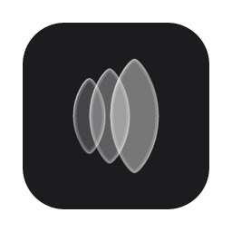

<p align="center">
  
</p>

<h1 align="center">Lenstica</h1>

<p align="center">
  Security monitoring for developers.
</p>

<p align="center">
  <a href="LICENSE"></a>
  
</p>

Lenstica is a security monitor for your development machine. It sets a 7-day
cooldown in your JavaScript, Python and Rust package managers, so they only
install versions at least a week old. It also watches for malicious packages,
exposed credentials, poisoned AI-agent instructions and services other
devices on your network can reach.

Each check is a **lens** that looks for one kind of risk. Findings appear in
the menu bar, the window, the CLI and your AI agent, each with a remedy and
often a one-click fix.

## Features

| Feature | What it does |
|---------|--------------|
| **Cooldown everywhere** | Sets a 7-day minimum release age in npm, pnpm, Yarn, Bun, uv, pip, Poetry and Cargo, and restores it if something resets it |
| **Dependency audit** | Finds too-new and deprecated packages in every lockfile, worktree and global install, and, if you turn them on, vulnerable and malicious ones |
| **Exposed secrets** | Finds credentials that malware running as you could steal, without storing or showing their values |
| **AI-agent instructions** | Flags hidden text, prompt injection and risky settings in CLAUDE.md, AGENTS.md, skills, hooks and MCP configs |
| **Network exposure** | Shows what accepts connections and flags debuggers, databases, container ports and dev servers that other devices on your Wi-Fi can reach |
| **Software ages** | Flags package managers, Homebrew formulae and casks, Rust toolchains and Node.js releases that are too new |
| **One-click fixes** | Fixes findings from the menu or the CLI, and backs up every file it edits |
| **Your own lenses** | Runs your own checks: a Rust crate, any CLI that prints JSON, or gitleaks, osv-scanner and trufflehog |
| **Local first** | Runs on your machine, with no account and no telemetry |

## Why a cooldown?

- Most malicious package versions are caught and pulled within hours or days.
- Of ten prominent supply-chain attacks in 2024 and 2025,
  [eight were live for less than a week](https://blog.yossarian.net/2025/11/21/We-should-all-be-using-dependency-cooldowns),
  so a 7-day cooldown would have kept them out.
- The major JavaScript, Python and Rust package managers all support a
  minimum release age now, but each has its own setting name, unit and config
  file. Lenstica sets them all and keeps them set.
- To set them by hand instead, see [docs/cooldown.md](docs/cooldown.md).

## Installation

> [!NOTE]
> Lenstica 0.1 has no prebuilt releases yet. Build it from source with
> [Rust](https://rustup.rs) 1.90 or newer.

```sh
git clone https://github.com/lenstica/lenstica.git && cd lenstica
cargo install --path .
```

- **Linux**: first install `libgtk-3-dev libayatana-appindicator3-dev
  libwebkit2gtk-4.1-dev`, or build the CLI without the menu bar app:
  `cargo install --path . --no-default-features --features secrets`.
- **Native packages** (`.app`/`.dmg`, `.msi`, `.deb`/`.rpm`/`.AppImage`): run
  `cargo install tauri-cli --version "^2" --locked && CI=true cargo tauri build`.

## Quick start

```sh
lenstica apply              # set the 7-day cooldown in each supported package manager
lenstica status             # run the lenses and show what needs attention
lenstica autostart install  # start the menu bar app at every login
```

- Lenstica searches whichever of `~/Developer`, `~/Projects`, `~/src`,
  `~/code`, `~/dev`, `~/repos` and `~/workspace` exist. To change that, edit
  `scan.roots` in `~/.config/lenstica/lenstica.toml` or open Settings in the
  window.
- To change the cooldown, run `lenstica set <days>`.
- `lenstica network` lists what accepts connections, and from where.
- `lenstica check` exits with status 1 when something needs attention, for
  scripts and CI.
- `lenstica --help` lists every command.

## Lenses

Each lens looks for one kind of risk and belongs to one or more categories,
which organise the window and the menu bar menu. `lenstica lenses` lists
them, and [docs/lenses.md](docs/lenses.md) describes each one.

| Category | Lens | Finds |
|----------|------|-------|
| AI agents | `agent-instructions` | Poisoned AI-agent instructions and risky agent settings |
| Packages | `package-managers` | Missing or weaker cooldown settings |
| Packages | `project-settings` | Repository files that lower the cooldown |
| Packages | `package-age` | Locked or installed versions younger than the cooldown |
| Packages | `install-scripts` | Package managers that run install scripts |
| Packages | `deprecated` | Deprecated (npm) or yanked (PyPI, crates.io) versions |
| Packages, Malware | `vulnerabilities`\* | Known vulnerabilities and malware, from OSV.dev |
| Software | `software` | Installed software younger than the cooldown |
| Software | `homebrew-updates` | Homebrew auto-updating before every install |
| Secrets | `secrets` | Credentials malware could steal |
| Malware, Privacy | `aikido-malware`\* | Packages on Aikido Intel's malware and telemetry lists |
| Malware | `safe-chain`\* | Whether Aikido Safe Chain is set up |
| Network | `listening-ports` | Debuggers, databases, container ports and dev servers reachable from your network |

\* Relies on a third party, so it is off until you turn it on in its
category (or with `enabled = true` under `[lenses.<id>]`).

## AI agents

Lenstica can hand its findings to Claude Code and other coding agents:

- **Prompt**: click **Copy Prompt for AI Agent** on any finding, or run
  `lenstica prompt`. The prompts are templates you can change in Settings.
- **Skill**: `lenstica skill --install` teaches Claude Code the CLI.
- **MCP server**: `claude mcp add --scope user lenstica -- lenstica mcp`, or
  `lenstica mcp --setup` for other agents.

## Privacy

Lenstica has no account and no telemetry. It sends only what it needs to look
things up:

- Names and versions of public packages, to their registries
- Versions of installed software, to their release sites, to date them
- Only if you turn on the `vulnerabilities` lens: package names and
  versions to OSV.dev
- Only if you turn on the `aikido-malware` lens: a download of Aikido's
  malware lists, whole

It never sends:

- Package names to Aikido
- Anything about private-registry, git or local dependencies
- Secret values, which it never stores, logs, shows or puts in prompts

## Documentation

- [The cooldown](docs/cooldown.md): each package manager's setting
- [Lenses](docs/lenses.md): every lens in detail
- [Configuration](docs/configuration.md): the settings file
- [The app](docs/app.md): menu bar, window and notifications
- [AI agents](docs/ai-agents.md): prompts, skill and MCP server
- [Writing lenses](docs/writing-lenses.md): how to add your own
- [Translating](docs/translating.md): how to add a language
- [SPEC.md](SPEC.md): architecture and roadmap

## Contributing

Issues and pull requests are welcome. Please open an issue before a large
change.

```sh
cargo test --workspace
cargo clippy --all-targets --workspace
cargo build && HOME=$(mktemp -d) target/debug/lenstica apply   # try changes without touching your real configs
```

The window is a Svelte app in `ui/`. Its build output in `assets/ui/` is
committed, so building Lenstica needs no Node; after changing `ui/`, rebuild
it and commit both:

```sh
cd ui && pnpm install && pnpm check && pnpm build
```

Build pages from the components in `ui/src/lib/components/` (every button
and field is one height, `h-control`), and put any text the app shows in
`i18n/en.json` rather than in the code, so it can be translated: `t("key")`
in the window, `t!("key")` in Rust.

- Never print, log or store a secret value, even in tests.
- Pin new dependencies to a release at least 7 days old.
- Keep the README, `docs/` and `SPEC.md` up to date.

## Security

Please report vulnerabilities through
[private vulnerability reporting](https://github.com/lenstica/lenstica/security/advisories/new),
not in public issues.

## Thanks

Thanks to [Tim Mikeladze](https://github.com/TimMikeladze) for the script that
inspired Lenstica.

## License

[Apache 2.0](LICENSE), see [NOTICE](NOTICE). Icons are from
[Lucide](https://lucide.dev) (ISC).
